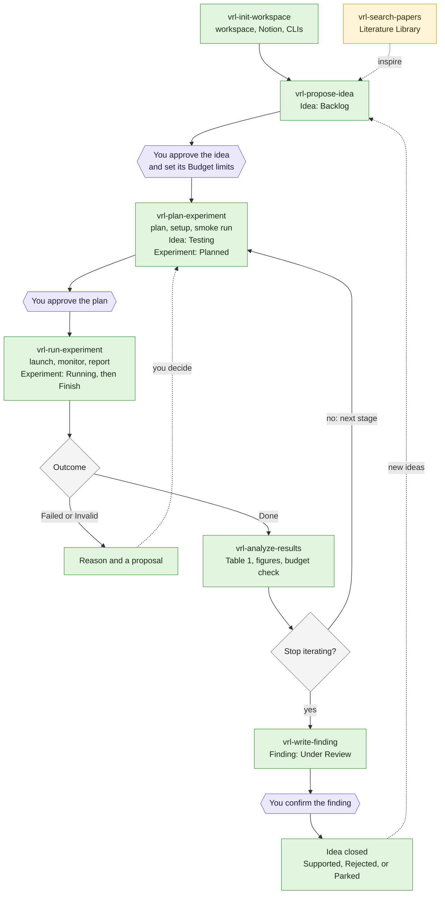

# vibe-research-loop-skills

Agent skills for the vibe-research-loop guide, the research workflow in which AI coding agents run the experiment loop and the user makes the decisions. Each skill is a folder under [`skills/`](skills/) with a `SKILL.md`, in the Agent Skills format that both Claude Code and Codex load.

| Skill | What it does | Invoked by |
|---|---|---|
| [`vrl-init-workspace`](skills/vrl-init-workspace/SKILL.md) | Sets up the workspace, the memory store (Notion, or Feishu) with its CLI and pages, and optionally a Hugging Face bucket, or adds a machine to them, from the guide's setup prompts | The user only |
| [`vrl-propose-idea`](skills/vrl-propose-idea/SKILL.md) | Writes a testable hypothesis into Ideas, for the user to approve | The user or the agent |
| [`vrl-plan-experiment`](skills/vrl-plan-experiment/SKILL.md) | Plans the next experiment of an approved idea, for the user to approve | The user or the agent |
| [`vrl-run-experiment`](skills/vrl-run-experiment/SKILL.md) | Launches and monitors the approved runs, then closes the experiment with its outcome | The user or the agent |
| [`vrl-analyze-results`](skills/vrl-analyze-results/SKILL.md) | Fills the results and conclusion of a finished experiment | The user or the agent |
| [`vrl-write-finding`](skills/vrl-write-finding/SKILL.md) | Drafts a finding from an idea's experiments, or from any verified result such as a performance test, for the user to confirm, then closes the idea it resolves, if any | The user or the agent |
| [`vrl-search-papers`](skills/vrl-search-papers/SKILL.md) | Adds at most three papers per search to the Literature Library | The user or the agent |
| [`vrl-night-watch`](skills/vrl-night-watch/SKILL.md) | Keeps the GPUs busy overnight with approved experiments, without asking anything, and leaves a morning report | The user, through a loop or a scheduled automation |

## Install in one prompt

Paste this into Claude Code or Codex, and approve the command when the agent asks: it needs the network and writes to `~/.agents` and `~/.claude`, outside the project.

```text
Install the vibe-research-loop skills by running `curl -fsSL https://raw.githubusercontent.com/Beat-in-our-hearts/vibe-research-loop-skills/main/install.sh | bash`, then tell me which skills it installed, anything it left alone, and the next step it prints.
```

To install by hand, or to update or remove the skills, see [Installing](#installing).

## Installing

Once per machine, run the installer. It needs only `curl` and `tar`, no sudo and no clone: it downloads the latest release to a temporary folder, copies each skill into `~/.agents/skills`, which Codex reads, and links it from `~/.claude/skills`, which Claude Code reads:

```bash
curl -fsSL https://raw.githubusercontent.com/Beat-in-our-hearts/vibe-research-loop-skills/main/install.sh | bash
```

Run it again to update; it also removes skills a newer release dropped. When a skill starts, it checks for a newer release, asking GitHub at most once a day, and tells you if there is one; it never updates on its own. Only releases this installer put in place are checked, not a branch or commit, nor an install by other means such as `skills` below. Add `-s -- --version v0.1.0` after `bash` to install a given tag, branch, or commit, or `-s -- --uninstall` to remove the skills. It replaces only folders it installed itself, and links to an old clone of this repository; it reports any other folder with a skill's name and leaves it alone. Start a new session if a skill does not show up.

With Node.js, [`skills`](https://github.com/vercel-labs/skills) installs them too: `npx skills add Beat-in-our-hearts/vibe-research-loop-skills -g -a claude-code -a codex --all`.

The skills use four CLIs: `uv`, `ntn` (Notion), `gh` (GitHub), and `hf` (Hugging Face); a workspace that keeps its research memory in Feishu (飞书) uses `lark-cli` in place of `ntn`. `vrl-init-workspace` installs them and logs in to them; to do that without an agent, run its script in a terminal. It needs no sudo and installs into `~/.local/bin`; add `check` to see what is installed and logged in, `install --upgrade` to upgrade them to their latest releases, or `--only ntn,gh` for a subset:

```bash
bash ~/.agents/skills/vrl-init-workspace/scripts/setup_clis.sh
```

## Workflow



Green steps are what the agent does, each with the Notion status it leaves behind. Purple steps wait for you: nothing past them runs until you act. Each experiment runs one stage of the idea, or the part of it that fits the budget left. The agent stops iterating on an idea when the success criteria are met, a Budget limit is reached, or several experiments in a row bring no improvement. Dashed arrows are the loops back: papers and closed ideas inspire new ideas, and a failed or invalid run goes back to planning once you decide how. vrl-search-papers also runs daily and after each experiment, to look for related work.

## Using

| Agent | Invoke a skill |
|---|---|
| Claude Code | `/vrl-plan-experiment`, followed by any details |
| Codex | `$vrl-plan-experiment`, followed by any details |

The agent also picks a research skill on its own when a request matches its description; `vrl-init-workspace` runs only when the user invokes it, and `vrl-night-watch` only when the user starts it, since a loop can run only a skill the agent may invoke: its description tells the agent never to pick it on its own, and in Codex its policy forbids that.

- Run `vrl-init-workspace` first, once per machine. It carries its own copy of the guide, so the guide never needs to be cloned. The research skills rely on the workspace's rules and on the page templates in that guide, so the Notion databases need no templates of their own: each page is written from its database's template one section at a time, as the section is filled, and the template's instructions stay in the template, so a page holds only content. Each idea, experiment, and finding page opens with a callout that says what you decide and how.
- The research skills write Notion pages in the reply language, unless the workspace's language rules set another one for Notion, but use the English names of the Notion databases and properties, the ones `vrl-init-workspace` creates.
- Start the agent from the workspace root; the research skills stop anywhere else.
- Before bed, start `/loop /vrl-night-watch` in Claude Code, or run `$vrl-night-watch` every half hour from a Codex automation in the workspace itself. From 22:00 to 10:00, or the hours you give it, the agent launches approved experiments whenever a GPU is free, asks you nothing, and leaves a morning report of what ran and what waits for you. It gives you beforehand the exact rules to allow without a prompt, for your own settings: those that check, count, launch a run of an approved plan, or write the memory store's pages, and none that runs any command or edits the rules, plans, `.env`, or code. These rules match the text of a command, so they are the only guard and an imperfect one: an allowed page write can still tick Human Approved, so keep the watch to nights you have approved what should run.
- Four scripts in [`skills/vrl-init-workspace/scripts/`](skills/vrl-init-workspace/scripts/) do the steps an agent should not improvise, and the skills call them; each explains itself with `--help`:

  | Script | Does |
  |---|---|
  | `launch_run.sh` | Launches a long-running command from the workspace root with its log header and footer, in tmux or in the background; launches a run of an approved plan only while the plan file has the hash recorded at approval and the code matches the plan's pin; refuses a second copy, a run that has ended unless told to restart or resume it, a job scheduler, a command that sets `CUDA_VISIBLE_DEVICES`, and a command that seems to hold a secret |
  | `resources.sh` | Prints the GPU, memory, and storage rows of a report, and which GPUs are free: no process, idle in two samples, and claimed by no running log |
  | `gpu_hours.py` | Counts the single-GPU hours that runs took, from their logs, for an idea's budget, and exits 3 when it cannot count them all |
  | `vrl_ssh.sh` | Reaches the remote host in remote mode through one SSH master, with time limits: runs commands there, copies commits to its mirrors of your checkouts, reads results, and brings back figures to upload. It never asks for a password: when the login needs one, it prints the command for you to run in your own terminal |
- The research skills keep the IDs of the Notion project page and databases in the workspace's `docs/notion/ids.md`.
- The research memory can live in Feishu (飞书, the China edition) instead of Notion: `vrl-init-workspace` asks which. In Feishu, each project is a wiki doc with a Base holding the Ideas, Experiments, and Findings tables, and each entry is a record plus a doc for its body; the workspace's `docs/AGENTS/feishu.md` tells the research skills what each Notion step becomes. Everything else, the review by colors included, works the same, except that record fields carry no color: review their values in the entry's doc.

## Reviewing a Notion page

Review a page the agent wrote by coloring its text, either the text itself or its background, in the Notion app. Before every write, the research skills read these colors, table cells included, and answer each mark:

| Color | You mean | The agent |
|---|---|---|
| 🔴 Red | This is wrong | Fixes it, and says what it changed and why |
| 🟠 Orange | I did not understand this | Explains it in plainer words, and rewrites it so that it no longer needs the explanation |
| 🟣 Purple | I cannot accept this | Proposes an alternative, and leaves the text and its mark until you decide |

Rewritten text loses its mark; a mark the agent has not resolved stays in place. Other colors carry no meaning, such as the blue background of an idea's line of thought.

## Remote mode

When the machine you run the agent on has no GPU and jobs run on a remote host over SSH, such as an HPC container, choose remote mode in `vrl-init-workspace`. Your code stays on your machine, which runs none of it; the remote host runs it all and keeps every result. Its prompts live in [`skills/vrl-init-workspace/references/remote/`](skills/vrl-init-workspace/references/remote/), outside the bundled guide, so that refreshing the guide leaves them alone.

| | Local machine: the workspace root | Remote host: the remote workspace |
|---|---|---|
| Files | The workspace repository (`AGENTS.md`, `docs/`, `tests/`), the code and its worktrees, and a `.env` holding only the time zone | Mirrors of the workspace repository and of each checkout, `.env`, environments, `data/`, `logs/`, `runs/`, `.cache/` |
| Commands | File edits, git, `vrl_ssh.sh`, `ntn` or `lark-cli`, `gh`, web requests; no Python, environment, test, or linter | Everything that runs code, through one SSH master and a tmux session |
| Git | Every repository, with every commit and push | Mirrors only, written by `vrl_ssh.sh sync` |

Code reaches the remote host only as commits: the agent commits a change, as your git level allows, and `vrl_ssh.sh sync` pushes it through the SSH master into a mirror at the same path, checked out with no branch. A sync refuses, changing nothing, while a run still uses that checkout or while the mirror holds a change no sync made, such as a file a run wrote there. Logs and results stay on the remote host, where the agent reads them, and only a figure to upload to Notion comes back. `launch_run.sh`, `resources.sh`, and `gpu_hours.py` refuse to run on your machine.

The remote host is named by an alias in your `~/.ssh/config`, such as `gpu-box`, so a jump host or a key works as it does in your own `ssh`; if you have none, the setup adds one with your approval. Give each local machine a remote workspace of its own. The research skills switch to remote mode whenever `docs/AGENTS/remote.md` exists at the workspace root. Start the SSH master before a session there with `vrl_ssh.sh connect <alias>`.

## Compatibility

| | Claude Code | Codex |
|---|---|---|
| Personal skill folder | `~/.claude/skills/` | `~/.agents/skills/` |
| Skills only the user invokes | `disable-model-invocation: true` in `SKILL.md` | `policy.allow_implicit_invocation: false` in `agents/openai.yaml` |
| `agents/openai.yaml` | Ignored | Display name, short description, default prompt, and invocation policy |

Each agent ignores the other's settings, so one folder serves both.

## Maintaining

Test the scripts with `bash tests/scripts/run.sh`, which runs them against stand-ins for `ssh` and `nvidia-smi`; GitHub Actions runs the same tests, with shellcheck, on Linux and macOS whenever the scripts change.

`skills/vrl-init-workspace/references/guide/` began as a copy of the English guide, and since 0.2.0 this copy is the source of truth: the skills' workspace rules and templates depend on it, so change it here, with the skills that use it, and port the change to the guide afterwards. Never overwrite it with the guide's files.

## Upgrading from 0.1.x

Install the new release as above. A workspace set up by 0.1.x has older rule files, so ask the agent to bring them up to date from the bundled guide, on every machine, since `docs/AGENTS/machine.md` and, in remote mode, `docs/AGENTS/remote.md` belong to one machine each:
- Rebuild each file in `docs/AGENTS/` from its template, `remote.md` included in remote mode, then apply your own changes again; merging the new text into the old would keep rules the templates dropped, such as running `ssh` by hand or writing a log header yourself.
- Redo step 4 of "Set up a workspace" in `workspace_prompts.md`, or step 5 of "Set up a remote workspace" in `remote_prompts.md`, which fills the new rows of `docs/AGENTS/machine.md`: the tmux session with the command that starts it, and the path of the VRL scripts. A proxy the machine needs moves into `.env`.
- Add the GPU hours row to section 5 of each finished experiment, from `gpu_hours.py` on its log folder, since the budget left now counts those rows.
- Experiments planned before the upgrade have no plan blocks, so finish them by hand, or plan them again.
- A remote-mode workspace no longer mounts the remote host, and its code moves to your machine. Once no run is going:
  1. Have the agent commit any change made on the remote host and push it, or save it as a patch.
  2. Unmount the old mount yourself, and move the old launch directory aside.
  3. In a new, empty directory, which becomes the workspace root, clone the workspace repository and the code. Replace the workspace repository's `.gitignore` with the one in step 3 of "Set up a remote workspace", which tracks `AGENTS.md` and keeps `docs/AGENTS/machine.md` and `docs/AGENTS/remote.md` out, and bring `AGENTS.md` and `docs/AGENTS/` over from the old launch directory.
  4. Write the local `.env` and the new `remote.md` as that prompt says, and add `PYTHONPYCACHEPREFIX` and the time zone to the remote `.env`.
  5. Sync `.` and every checkout. A remote checkout that still holds a change of its own refuses the first sync until the change is moved away; the old remote workspace repository becomes the mirror of `.` once your clone's history is synced into it.

## License

[MIT](LICENSE), © 2026 Zuxing Lu.
